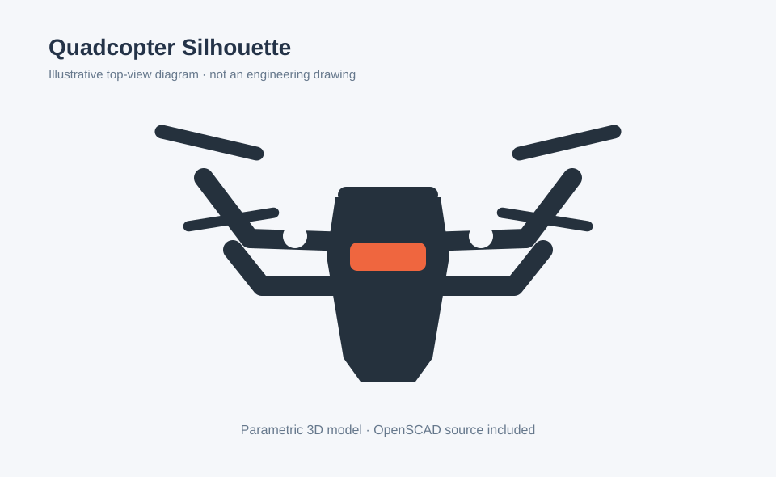

# Quadcopter Silhouette — демонстрационная 3D-модель

**Авторская параметрическая модель внешнего силуэта квадрокоптера.** Общая идея вдохновлена визуальным обликом воздушных мишеней (в том числе I.D. R.A.D.), но это **не изделие Infinity Targets** и не официальный чертёж. Модель предназначена для визуализации и изучения 3D-моделирования.



## Файлы проекта

- `model/drone_silhouette.scad` — редактируемый параметрический исходник OpenSCAD.
- `preview/outline.svg` — схематическая иллюстрация геометрии.
- `.github/workflows/export-stl.yml` — сборка STL через GitHub Actions.
- `.gitignore` — исключения для временных файлов.

## Габариты и параметры

- Ориентировочные габариты по умолчанию: **362 × 139 мм**.
- Толщина основного тела: **6 мм**.
- Толщина декоративной накладки: **2 мм**.
- Параметры `scale_factor`, `body_thickness` и `accent_thickness` изменяются в исходном SCAD-файле.

## Как получить STL

**Вариант 1 — на компьютере:** установи [OpenSCAD](https://openscad.org/), открой `model/drone_silhouette.scad`, затем используй команды:

```bash
mkdir -p mesh
openscad -o mesh/body.stl -D 'part="body"' model/drone_silhouette.scad
openscad -o mesh/accent.stl -D 'part="accent"' model/drone_silhouette.scad
```

**Вариант 2 — через GitHub:** открой вкладку **Actions** → **Export STL meshes** → **Run workflow**. После успешной сборки открой её страницу и скачай **quadcopter-stl** в разделе **Artifacts** (при доступности GitHub Actions). Папка `mesh/` создаётся при сборке; сгенерированные STL не включены в исходный репозиторий.

## Ограничения и использование

**Только декоративный макет.** Геометрия не рассчитывалась и не испытывалась для буксировки, подвешивания, ветровых нагрузок, полётов или огневых испытаний. Не используй её как функциональную воздушную или стрелковую мишень. Здесь нет узлов подвеса и креплений, прочностных расчётов и характеристик материала. Схема SVG служит иллюстрацией, а не конструкторским чертежом.

Референс общего визуального подхода: [I.D. R.A.D. Target System](https://infinitytargets.com/pages/id-rad-target-system). Все товарные знаки принадлежат их владельцам.

**Лицензия:** не назначена. Публичность репозитория не означает разрешение на свободное использование или распространение кода.
